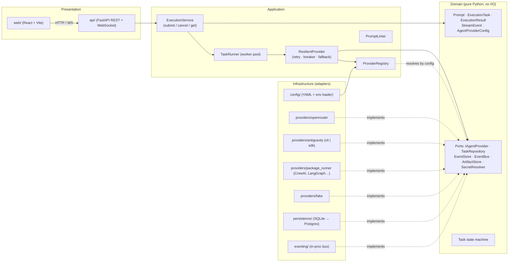
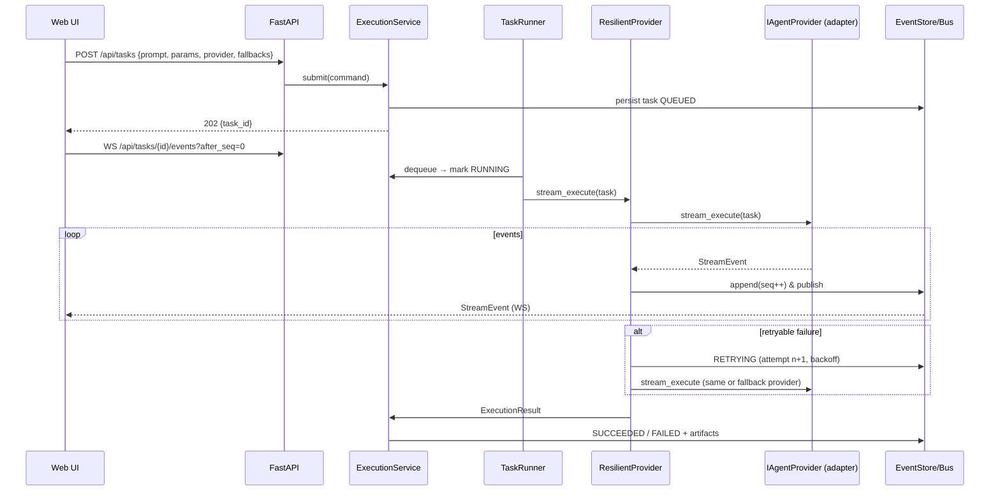
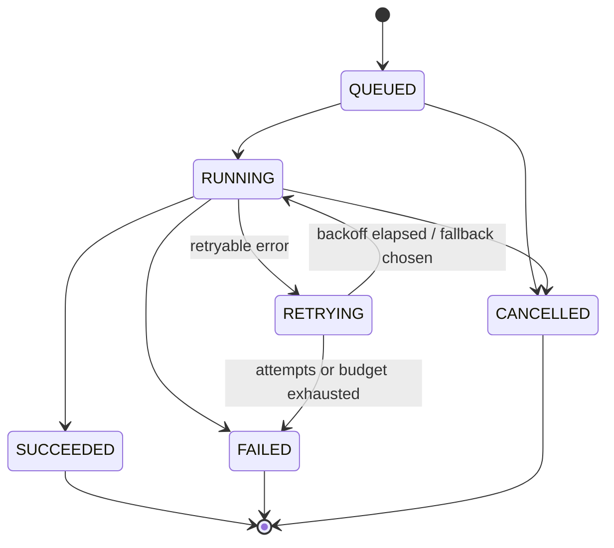

# Vibe Forge — Project Plan & Architecture Blueprint

> Working name: **Vibe Forge**. Status: **DRAFT — awaiting review** (no code scaffolded yet).

A web platform where users author prompts ("vibes") and run them against pluggable
agent back-ends (OpenRouter, Antigravity headless CLI/SDK, third-party packages),
with live streaming, task lifecycle tracking, history, and an artifact viewer.

**Prime directive:** adding a provider = *adding* files + one config entry.
Zero edits to `domain/`, `application/`, `api/`, or `web/`.

---

## 0. Environment Findings (verified on this machine)

| Item | Finding | Consequence |
|---|---|---|
| Python | 3.10.9 | Target `>=3.10`. No `StrEnum`, `tomllib`, `ExceptionGroup`, `TaskGroup`. Use `str, Enum` and `asyncio.gather`/`anyio`. |
| Node / npm | v24.3.0 / 11.4.2 | Fine for Vite 6+/React 19. |
| `agy` CLI | **Not on PATH** | Adapter must degrade gracefully: `health_check()` returns `False` with a clear reason; UI shows provider as "unavailable". |
| Antigravity SDK | `pip install google-antigravity` (compiled binary per platform wheel) | Python-version support unverified → check in Phase 2 spike. |
| Headless CLI | `agy -p "<prompt>"` with `--output-format text\|json\|stream-json`, `--json-schema`, `--print-timeout`, `--dangerously-skip-permissions` | **Flags came from a web search, not `agy --help`.** Adapter builds argv from a *configurable template* and parses NDJSON tolerantly; verify once `agy` is installed. |

---

## 1. Architecture Overview

Hexagonal / Clean Architecture. Dependencies point **inward only**.



### Dependency rule (enforced, not just documented)

| Layer | May import | Must NOT import |
|---|---|---|
| `domain` | stdlib only | everything else |
| `application` | `domain` | `infrastructure`, `api`, FastAPI, httpx, SQLAlchemy |
| `infrastructure` | `domain`, `application` ports | `api`, other providers |
| `api` (composition root) | all | — (the *only* place that wires concrete classes) |

Enforced in CI with **import-linter** contracts (`layers`, `forbidden`, and an
`independence` contract so providers can't import each other).

### Execution flow



---

## 2. Domain Layer (`backend/vibe/domain`)

Frozen `dataclass`es — no Pydantic, no I/O. Pydantic lives only at the API boundary.

| Model | Key fields |
|---|---|
| `Prompt` | `id`, `title`, `system_instructions`, `user_prompt`, `parameters: dict[str, ParamValue]`, `version`, `created_at` |
| `ExecutionParams` | `model`, `temperature`, `max_tokens`, `budget_usd`, `timeout_s`, `provider_id`, `fallback_provider_ids: tuple[str, ...]`, `extra: Mapping` (provider-specific passthrough) |
| `ExecutionTask` | `id`, `prompt_snapshot` (immutable copy), `params`, `status`, `attempt`, `attempts: tuple[Attempt, ...]`, `workspace` (optional), `created_at`, `idempotency_key` |
| `ExecutionResult` | `task_id`, `status`, `output_text`, `artifacts: tuple[Artifact, ...]`, `usage: Usage`, `provider_id`, `error: ProviderError \| None`, `duration_ms` |
| `Artifact` | `id`, `kind` (`diff`\|`file`\|`log`\|`json`), `path`, `mime`, `content_ref`, `size` |
| `StreamEvent` | `task_id`, `seq`, `attempt`, `ts`, `type`, `data` |
| `AgentProviderConfig` | `id`, `kind`, `display_name`, `adapter` (import path), `enabled`, `options`, `capabilities`, `secrets_ref` |
| `ProviderCapabilities` | `streaming`, `supports_cancel`, `idempotent` (safe to auto-retry), `can_modify_workspace`, `reports_usage`, `models: tuple[str,…]` |

**`StreamEvent.type`:** `status` · `token` · `thought` · `tool_call` · `tool_result` · `log` · `artifact` · `usage` · `error` · `done`.

**Task state machine** (pure function `transition(state, event) -> state`, illegal transitions raise):



(`CANCELLED` is added to the brief's five states — a UI "stop" button needs it.)

**Error taxonomy** (`domain/errors.py`) — drives resilience decisions, not string matching:

`RateLimited(retry_after)` · `ProviderTimeout` · `TransientProviderError` · `StreamDisconnected` ·
`AuthenticationError` ✗ · `InvalidRequest` ✗ · `ContentRejected` ✗ · `BudgetExceeded` ✗ · `ProviderUnavailable`  (✗ = never retried).

### The provider contract (`domain/ports/agent_provider.py`)

```python
class IAgentProvider(Protocol):
    config: AgentProviderConfig

    @property
    def capabilities(self) -> ProviderCapabilities: ...

    async def execute(self, task: ExecutionTask) -> ExecutionResult: ...
    def stream_execute(self, task: ExecutionTask) -> AsyncIterator[StreamEvent]: ...
    async def health_check(self) -> HealthStatus: ...   # see note
    async def cancel(self, task_id: str) -> None: ...   # no-op if unsupported
    async def aclose(self) -> None: ...
```

Deviations from the brief, deliberately:
- `health_check() -> HealthStatus(ok: bool, reason: str | None, latency_ms)` — a bare `bool` can't tell the UI *why* `agy` is missing. `bool(status)` still works.
- Added `cancel` and `aclose` — subprocess/HTTP lifecycles need them.
- A **`BaseAgentRunner`** ABC provides template-method glue: `execute()` defaults to folding `stream_execute()` into a result, so simple adapters implement *only* `stream_execute`.

---

## 3. Application Layer (`backend/vibe/application`)

| Component | Responsibility |
|---|---|
| `ExecutionService` | Use cases: `submit`, `cancel`, `retry_manually`, `get`, `list_history`, `replay_events(after_seq)`. Owns state transitions. |
| `TaskRunner` | `asyncio` worker pool over a `TaskQueue` port; concurrency limit per provider (semaphore). On startup, re-queues tasks left `RUNNING` by a crashed process. |
| `ProviderRegistry` | `register(config)`, `resolve(provider_id) -> IAgentProvider`, `list()`, cached health. Instantiates adapters from config via import path or entry point. |
| `ResilientProvider` | Decorator over `IAgentProvider` implementing the `execution-resilience-skill` policies (see §6). |
| `EventPublisher` | Assigns monotonically increasing `seq`, persists, then fans out. |
| `PromptLinter` | Deterministic checks (structure, schema present, guardrails, rough token estimate) → `LintReport`. Surfaced in the editor; same rubric as the skill. |
| `BudgetGuard` | Pre-flight + running cost/token checks against `budget_usd` / `max_tokens`. |

### Registration mechanism (the extensibility core)

`config/providers.yaml`:

```yaml
providers:
  - id: openrouter-default
    kind: openrouter
    adapter: vibe.infrastructure.providers.openrouter:OpenRouterProvider
    enabled: true
    options:
      base_url: https://openrouter.ai/api/v1
      default_model: anthropic/claude-sonnet-4
      api_key: ${OPENROUTER_API_KEY}      # env interpolation only; never literals
      provider_routing: { order: [anthropic], allow_fallbacks: true }
  - id: antigravity-headless
    kind: antigravity
    adapter: vibe.infrastructure.providers.antigravity:AntigravityProvider
    options:
      mode: cli                           # cli | sdk
      executable: agy
      args_template: ["-p", "{prompt}", "--output-format", "stream-json"]
      allowed_workspaces: ["C:/Dev/sandbox"]
      skip_permissions: false
      print_timeout: 5m
  - id: crewai-research
    kind: package
    adapter: vibe.infrastructure.providers.package_runner:PackageRunnerProvider
    options:
      mode: inprocess                     # inprocess | subprocess
      entrypoint: my_pkg.crew:run_stream
```

Resolution order: (1) `adapter` import path, (2) Python entry-point group `vibe.providers` keyed by `kind`
(lets **pip-installed third-party packages** self-register), (3) fail closed with a clear error.
Config is validated with a JSON-schema at startup; one bad provider disables *itself*, not the app.
The factory contract: `def create(config: AgentProviderConfig, deps: ProviderDeps) -> IAgentProvider`.

---

## 4. Infrastructure Layer (`backend/vibe/infrastructure`)

### Providers (each is an isolated package: own tests, own optional deps, no cross-imports)

| Provider | Notes |
|---|---|
| **`openrouter`** | `httpx.AsyncClient` + SSE parsing of `/chat/completions` (`stream: true`). Maps params → body (`model`, `temperature`, `max_tokens`, `provider`, `models` fallback list, `transforms`). Reads `usage`/cost; maps HTTP 429/5xx/timeouts → domain errors (`Retry-After` honoured); treats SSE comment keep-alives and `: OPENROUTER PROCESSING` correctly; mid-stream error chunks → `StreamDisconnected`/`TransientProviderError`. Cancel = close the response. |
| **`antigravity`** | Two strategies behind one adapter: **`cli`** — `asyncio.create_subprocess_exec` (argv list, **never `shell=True`**) running `agy -p …` and parsing NDJSON (`stream-json`) → `StreamEvent`s, falling back to raw-line `log` events on unparseable output; **`sdk`** — `google.antigravity.Agent` + `agent.chat()` streaming tokens/thoughts/tool calls. No IDE GUI in either. Safety: `cwd` must sit inside an allow-listed workspace root; `--dangerously-skip-permissions` is **off by default** and opt-in per provider config; kill the whole process tree on cancel/timeout (Windows: `taskkill /T /F`); `idempotent=False` (agent edits files) so auto-retry after side effects is disabled unless the config says otherwise. Artifacts: `git diff` of the workspace before/after the run. |
| **`package_runner`** | Template for CrewAI / LangGraph / custom subagents. `inprocess`: imports `entrypoint` (async generator or callable) and adapts it; `subprocess`: runs a command speaking NDJSON `StreamEvent`s over stdout (language-agnostic, isolates dependency hell). Ships a documented example package. |
| **`fake`** | Deterministic scripted provider (configurable delays, injected failures). Used by tests, demos, and offline dev. |

### Other adapters
- **Persistence:** SQLAlchemy 2 (async) + SQLite (WAL) via `aiosqlite`; Alembic migrations; same code runs on Postgres. Tables: `prompts`, `tasks`, `attempts`, `events` (`task_id, seq` PK), `artifacts`.
- **Artifact store:** filesystem blobs under `data/artifacts/<task_id>/`, DB holds metadata (large diffs/logs don't bloat SQLite).
- **Event bus:** in-process pub/sub (`asyncio.Queue` per subscriber, bounded, drop-slow-consumer policy). Port allows swapping to Redis Streams later.
- **Secrets:** `EnvSecretResolver` (+ `.env`); a log filter redacts anything resolved from secrets.

---

## 5. Presentation Layer

### API (`backend/vibe/api`, FastAPI — the composition root)

| Method | Path | Purpose |
|---|---|---|
| `GET` | `/api/providers` | List providers + capabilities + live health |
| `POST` | `/api/providers/{id}/health` | Force re-check |
| `POST` | `/api/prompts/lint` | Run `PromptLinter` without executing |
| `CRUD` | `/api/prompts` | Save/version prompt drafts |
| `POST` | `/api/tasks` | Submit execution → `202 {task_id}` |
| `GET` | `/api/tasks` / `/api/tasks/{id}` | History (filter/paginate) / detail |
| `POST` | `/api/tasks/{id}/cancel` · `/retry` | Control |
| `GET` | `/api/tasks/{id}/artifacts[/{aid}]` | Artifact list / content |
| `WS` | `/api/tasks/{id}/events?after_seq=N` | Live stream; **resumable** via `seq` cursor (replays from the event store, then goes live) |
| `GET` | `/api/health` | Liveness |

- **Streaming choice:** WebSocket per the brief, but every event carries a persisted `seq`; a dropped socket reconnects with `after_seq` and loses nothing. Stream-disconnect resilience is thus a first-class feature of the UI too.
- **Security (non-negotiable — this app can run agents that edit files on the host):** binds `127.0.0.1` by default; bearer-token auth required for any non-loopback bind; CORS locked to the web origin; WebSocket origin check; request-size limits; per-IP rate limit on `POST /tasks`.
- Pydantic v2 request/response schemas; OpenAPI → TypeScript client generated for the frontend (single source of truth for types).

### Web (`web/`, Vite + React 19 + TypeScript)

- **Prompt Studio:** CodeMirror 6 editor (system instructions + user prompt, `{{variable}}` highlighting), parameter panel (provider dropdown with health dots, model, temperature slider, max tokens, budget, timeout, ordered fallback list), live lint panel + token estimate.
- **Execution Dashboard:** real-time terminal (xterm.js) fed by `StreamEvent`s with attempt separators; status timeline (Queued → Running → Retrying → Succeeded/Failed); cancel/retry; cost/token meter.
- **Artifact Viewer:** tabs for unified/split diffs, file tree + syntax-highlighted code, raw logs, JSON.
- **History:** filterable table, compare two runs, re-run from snapshot.
- **State:** TanStack Query (server state) + small Zustand store (editor/UI); a typed `useTaskStream` hook handles reconnect/`after_seq`.
- **Styling:** vanilla CSS with design tokens (HSL palette, dark-first, glass surfaces, micro-animations), Inter + JetBrains Mono. *Not Tailwind* — see Open Decision #3.

---

## 6. Project Skills & Rules

Authored as Antigravity skills (`SKILL.md` + YAML frontmatter, progressive disclosure) plus rules.

```
.agents/
  rules/
    architecture.md          # always_on: dependency rule, layer boundaries
    python-style.md          # py3.10 constraints, typing, async conventions
  skills/
    provider-scaffolder-skill/
      SKILL.md               # step-by-step blueprint
      templates/             # provider package skeleton, config snippet, test stubs
      scripts/scaffold_provider.py   # generates skeleton from a name + kind
    vibe-prompt-validator-skill/
      SKILL.md               # rubric + report format
      scripts/lint_prompt.py # deterministic checks, JSON output
    execution-resilience-skill/
      SKILL.md               # policies + decision tables
      references/error-taxonomy.md
AGENTS.md                    # repo-wide orientation + commands
```

| Skill | Core content |
|---|---|
| **provider-scaffolder-skill** | (1) Pick `kind`, run scaffold script → `infrastructure/providers/<name>/{adapter.py,mapping.py,errors.py,__init__.py}` + tests. (2) Implement `stream_execute` only; map native errors → domain taxonomy. (3) Declare `capabilities` honestly (esp. `idempotent`). (4) Add YAML entry (+ optional entry point). (5) **Must pass the shared provider contract test-suite** (`tests/contract/provider_contract.py`) and the import-linter gate. (6) Checklist forbidding edits outside the new package + config. |
| **vibe-prompt-validator-skill** | Rubric: role/goal clarity; explicit success criteria; Chain-of-Thought scaffolding *where the target model benefits* (not for reasoning models that do it natively); guardrails (scope, forbidden actions, refusal behaviour, prompt-injection hygiene for pasted content); output schema/format contract; examples; variable hygiene; token optimization (dedupe, trim boilerplate, cache-friendly stable prefix first). Output: scored `LintReport` JSON + prioritized fixes. |
| **execution-resilience-skill** | Decision tables per error class; exponential backoff + full jitter; honour `Retry-After`; per-provider circuit breaker (closed/open/half-open); fallback routing order & when *not* to fall back (auth/invalid-request, or non-idempotent after side effects); stream-disconnect handling (resume if supported, otherwise restart with an attempt boundary); timeouts (connect/first-token/idle/total); budget-aware retries; observability fields to log. |

The deterministic parts (linter, resilience policies) live in real code
(`application/`) and are *tested*; the skills teach agents how to extend and apply them — skills are not a substitute for code.

### Resilience policy defaults (in `ResilientProvider`)

| Error | Retry | Fallback | Notes |
|---|---|---|---|
| `RateLimited` | yes, wait `retry_after` or jittered backoff | after 2 tries or if `retry_after` > cap | breaker counts it |
| `ProviderTimeout` / `TransientProviderError` | yes (max 3) | after retries | backoff 1s→2s→4s ±jitter |
| `StreamDisconnected` | resume if capable, else restart | yes | new attempt boundary event; UI separates output |
| `ProviderUnavailable` | no | immediately | breaker opens |
| `AuthenticationError`, `InvalidRequest`, `ContentRejected`, `BudgetExceeded` | **never** | **never** | fail fast, surface to user |
| Any error after side effects on non-`idempotent` provider | **no auto-retry** | no | manual retry only |

---

## 7. Directory Structure

Maps to the brief's `/domain /application /infrastructure/providers /web /config /skills`
(Python layers live under one package so imports and linting are clean).

```
AI-Agents-App/
├─ PROJECT_PLAN.md
├─ AGENTS.md
├─ README.md
├─ .env.example
├─ .agents/                       # rules + skills (see §6)
├─ config/
│  ├─ providers.yaml              # provider registry definitions
│  ├─ providers.schema.json
│  ├─ app.yaml                    # queue size, concurrency, retention, resilience defaults
│  └─ providers.example.yaml
├─ backend/
│  ├─ pyproject.toml              # deps, ruff, mypy --strict, import-linter contracts
│  ├─ alembic/
│  ├─ vibe/
│  │  ├─ domain/                  # models, errors, state machine, ports/
│  │  ├─ application/             # services, runner, registry, resilience, linter, budget
│  │  ├─ infrastructure/
│  │  │  ├─ providers/
│  │  │  │  ├─ _base.py           # BaseAgentRunner
│  │  │  │  ├─ openrouter/
│  │  │  │  ├─ antigravity/
│  │  │  │  ├─ package_runner/
│  │  │  │  └─ fake/
│  │  │  ├─ persistence/
│  │  │  ├─ eventing/
│  │  │  ├─ artifacts/
│  │  │  └─ config/               # YAML+env loader, schema validation
│  │  └─ api/                     # FastAPI app, routers, schemas, deps (composition root)
│  └─ tests/
│     ├─ unit/ · integration/ · e2e/
│     └─ contract/provider_contract.py   # run against EVERY provider
├─ web/
│  ├─ package.json · vite.config.ts · tsconfig.json
│  └─ src/
│     ├─ api/ (generated client) · features/{studio,dashboard,artifacts,history,providers}
│     ├─ components/ · hooks/ · styles/ (tokens.css, base.css) · app/
├─ examples/package-runner-demo/  # sample third-party-style plugin
└─ scripts/                       # dev.ps1, lint, gen-client
```

---

## 8. Tech Stack & Justification

| Concern | Choice | Why / alternative rejected |
|---|---|---|
| Backend | **Python 3.10+, FastAPI, Uvicorn, anyio/asyncio** | Native async streaming + WS; Python is the lingua franca of agent frameworks (CrewAI, LangGraph, Antigravity SDK) → in-process plugins are trivial. *Rejected:* Next.js API routes (weaker long-running subprocess/queue story; Python ecosystem lock-out). |
| Validation | Pydantic v2 (API boundary only) | Keeps domain dependency-free. |
| HTTP client | httpx (async, HTTP/2 off by default) | Streaming support, timeouts granularity. |
| Persistence | SQLite (WAL) → Postgres, SQLAlchemy 2 async + Alembic | Zero-ops locally; port-based so Postgres is a config swap. *Rejected:* Redis/Mongo as primary (need durable, queryable history). |
| Queue | In-process `asyncio` queue behind `TaskQueue` port, durable via DB state + crash recovery | YAGNI on Celery/Redis; port keeps the door open. |
| Realtime | WebSocket + persisted `seq` replay | Bidirectional, resumable. (SSE is the fallback if WS proxies bite.) |
| Frontend | **React 19 + Vite + TypeScript** | Fast DX; clean split from API. *Rejected:* Next.js SSR (no SEO/SSR need for an authenticated tool). |
| Styling | Vanilla CSS + tokens | Full design control, no build coupling. |
| Editor/terminal/diff | CodeMirror 6 · xterm.js · `diff2html` (or `react-diff-view`) | Best-in-class, lightweight, themable. |
| Quality gates | ruff · mypy `--strict` (domain/application) · pytest + pytest-asyncio · import-linter · Vitest + Playwright | Boundaries enforced mechanically. |
| Observability | `structlog` JSON logs with `task_id/attempt/provider` bound; OpenTelemetry hooks stubbed | Debuggable multi-provider failures. |

---

## 9. Configuration Management

Precedence (high → low): **env vars** > `config/*.local.yaml` (git-ignored) > `config/*.yaml` defaults.
`${VAR}` interpolation in YAML; secrets are *only* ever referenced, never stored; `.env.example` documents all keys
(`OPENROUTER_API_KEY`, `VIBE_AUTH_TOKEN`, `VIBE_DB_URL`, `VIBE_WORKSPACE_ROOTS`, …). Startup validates everything and prints a provider status table.

---

## 10. Phased Delivery & Acceptance Criteria

| Phase | Scope | Done when |
|---|---|---|
| **1 — Plan** *(this doc)* | Blueprint | You approve / amend |
| **2 — Scaffold** | Dir tree, `pyproject`, import-linter contracts, config loader + schema, domain models/ports/state machine/errors, `BaseAgentRunner`, registry, `.agents/` skills + rules + `AGENTS.md`, provider scaffold script | `pytest` + ruff + mypy + import-linter green on empty-but-wired skeleton; `fake` provider resolves from YAML |
| **3 — Providers & pipeline** | `ExecutionService`, runner, event store, `ResilientProvider`, OpenRouter, Antigravity (cli+sdk), package runner | Shared contract suite passes for all providers; resilience scenarios (429, timeout, mid-stream drop, fallback, cancel) pass against `fake` + recorded OpenRouter fixtures; Antigravity verified live if `agy` installed, else `health_check` reports clearly |
| **4 — API & Web** | REST/WS API, Prompt Studio, Dashboard, Artifact Viewer, History | E2E (Playwright) with `fake` provider: submit → stream → diff artifact → history; WS reconnect resumes with no gaps/dupes |
| **5 — Hardening** *(optional)* | Auth, Docker, docs, CI | Clean-clone `README` quickstart works |

### Test strategy
- **Domain:** property tests on the state machine (no illegal transitions).
- **Contract suite:** one reusable parametrized suite every provider must pass (streams ordered events, ends with `done`, `execute` ≡ folded `stream_execute`, cancel stops promptly, errors map to taxonomy, secrets never appear in events).
- **"Open/closed" proof test:** CI scaffolds a throwaway provider via the skill script and asserts `git diff` touches **only** the new package + config.

---

## 11. Risks

| Risk | Mitigation |
|---|---|
| `agy` flags/NDJSON schema differ from what I found via search | Config-driven argv template; tolerant parser with raw-log fallback; verify with `agy --help` in Phase 2 |
| Antigravity SDK may not support Python 3.10 | Spike in Phase 2; fall back to `cli` mode, or require a newer Python for the `sdk` extra only |
| Agent runs mutate host files / run commands | Workspace allow-list, permission prompts not bypassed by default, loopback bind + auth, non-idempotent flag blocks blind retries |
| Mid-stream retry duplicates output or side effects | Attempt boundaries in event log; `idempotent` capability gate |
| Prompt/secret leakage via logs and events | Central redaction filter; contract test asserts no secret in events |
| Windows subprocess/tree-kill quirks | Dedicated tests on Windows; `taskkill /T /F` path |

---

## 12. Open Decisions (defaults chosen — change any before Phase 2)

1. **Stack:** FastAPI + Vite/React (default) vs Next.js full-stack.
2. **Skills location:** canonical in `.agents/skills/` (auto-discovered by Antigravity) vs a top-level `/skills` as the brief lists. Default: `.agents/skills/`, plus a thin `skills/README.md` index — avoids duplicates.
3. **Styling:** vanilla CSS design tokens (default) vs Tailwind.
4. **Streaming transport:** WebSocket w/ resume cursor (default) vs SSE.
5. **Database:** SQLite → Postgres-ready (default) vs Postgres from day one.
6. **Auth:** local-only + bearer token (default) vs multi-user accounts (out of scope for v1).
7. **Antigravity mode priority:** `cli` first, `sdk` second (default), depends on what you have installed.
