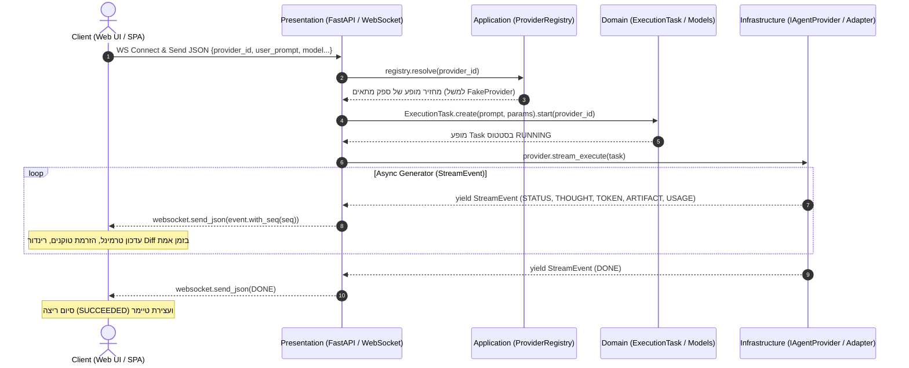

# ארכיטקטורת Vibe Forge – זרימת בקשה (Request Lifecycle)

המערכת בנויה לפי עקרונות ה-**Hexagonal / Clean Architecture**, ומופרדת לשכבות **Presentation**, **Application**, **Domain**, ו-**Infrastructure**.

מסמך זה מפרט את ה-Call Stack המלא, זרימת הבקשה, חלוקת האחריות בין השכבות, זהות הסוכן המטפל, ואופן החזרת התשובה ללקוח.

---

## 1. תרשים זרימת הבקשה (Call Stack Flow)



---

## 2. פירוט השכבות וחלוקת האחריות (Layers & Responsibilities)

| שכבה | רכיבים מרכזיים | תפקיד ואחריות בביצוע ה-Prompt |
| :--- | :--- | :--- |
| **Presentation (Client)** | `web/assets/js/app.js`, `web/index.html` | קליטת הקלט מהמשתמש, פתיחת חיבור WebSocket, שליחת הבקשה, וקבלת אירועי ה-Stream בזמן אמת לעדכון ה-DOM (טקסט, מחשבות, תצוגת קבצים/Diff). |
| **Presentation (Backend / API)** | `backend/app/vibe/api/main.py` (`websocket_execute`, `execute_task`) | **Composition Root** ונקודת כניסה לשרת. מאמתת את הקלט, מבקשת את הסוכן מה-Registry, יוצרת את מודלי ה-Domain ומזרימה את האירועים ל-Socket בפורמט JSON עם מספור רציף (`seq`). קיים גם נתיב REST חלופי. |
| **Application Layer** | `ProviderRegistry`, `PromptLinter`, `config/providers.yaml` | ניהול מחזור החיים ומצבי הבריאות של הספקים (`READY`, `DISABLED`, `FAILED`). אחראי על טעינת הקונפיגורציה ובידוד תקלות בספקים. |
| **Domain Layer** | `IAgentProvider`, `ExecutionTask`, `Prompt`, `state_machine.py` | **ליבת המערכת הטהורה** (ללא תלות בספריות חיצוניות או I/O). מגדירה את החוזים (Ports), מכונת המצבים של המשימה (`QUEUED` -> `RUNNING` -> `SUCCEEDED` / `FAILED`), ומבני הנתונים הבלתי משתנים (`StreamEvent`, `Artifact`, `Usage`). |
| **Infrastructure Layer** | `BaseAgentRunner`, `FakeProvider`, `OpenRouter`, `Antigravity` | מימוש ה-Adapters בפועל מול שירותי LLM חיצוניים או סוכני CLI. יורשים מ-`BaseAgentRunner` ומממשים גנרטור אסינכרוני `stream_execute`. |

---

## 3. מי הסוכן שמטפל בבקשה?

הסוכן שמטפל בבקשה נקבע **דינמית** על פי שדה ה-`provider_id` שנשלח בבקשה:

1. **ברירת המחדל הנוכחית (`FakeProvider`)**:
   * מוגדר ב-`config/providers.yaml` (ממומש ב-`backend/providers/vibe_providers/adapters/fake/adapter.py`).
   * ספק הדגמה וטסטים המדמה חשיבה (`EventType.THOUGHT`), הזרמת טוקנים בחלקים (`EventType.TOKEN`), יצירת קובץ שינויים (`changes.diff` כ-`EventType.ARTIFACT`), וחישוב צריכת טוקנים (`EventType.USAGE`).

2. **ספקים נוספים בהרחבה**:
   * **`OpenRouterProvider`** (`openrouter`) – מנתב את הפרומפט למודלים כגון Claude 3.5 Sonnet או GPT-4 דרך OpenRouter API.
   * **`AntigravityProvider`** (`antigravity`) – מריץ סוכן מקומי ללא מסך (Headless CLI / `agy`) ומאפשר פעולות ישירות בסביבת העבודה.

---

## 4. איך התשובה מוחזרת ללקוח?

התשובה מוחזרת באמצעות **Streaming אסינכרוני בזמן אמת**:

### א. בצד השרת (Backend)
בתוך הפונקציה `websocket_execute` (בקובץ `backend/app/vibe/api/main.py`), מתבצעת לולאת `async for event in provider.stream_execute(task):`. כל אירוע מקבל מזהה רץ `seq` ומומר ל-JSON:

```python
event_with_seq = event.with_seq(seq)
await websocket.send_json(event_with_seq.to_dict())
```

### ב. מבנה האירועים המוחזרים (`EventType`)
* `status`: שינוי סטטוס (`started`, `running`).
* `thought`: שרשרת מחשבה פנימית של הסוכן.
* `token`: טקסט שנוצר ומצטבר ברצף.
* `artifact`: קבצים או תוצרי קוד (כגון Unified Diff של שינויי קבצים).
* `usage`: כמות הטוקנים שנוצלה (Prompt & Completion) ועלות בדולרים.
* `done`: אירוע סיום המכיל את `finish_reason`.

### ג. בצד הלקוח (Browser)
הפונקציה `activeSocket.onmessage` (בקובץ `web/assets/js/app.js`) מפענחת כל Frame:
* **טוקנים (`token`)**: מוזרמים מידית לטרמינל.
* **תוצרים (`artifact`)**: מנותבים לפונקציה `renderDiff()` לצביעת שורות ה-Diff (`+` / `-`).
* **סיום (`done`)**: מעביר את ה-UI למצב `SUCCEEDED` ומעדכן את המונים הסופיים.