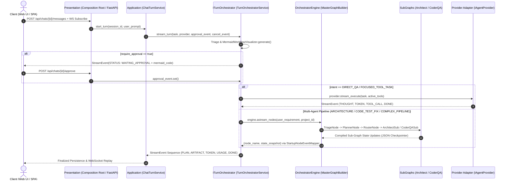

# ארכיטקטורת Vibe Forge – זרימת בקשה ואורקסטרציה (Request & Orchestration Lifecycle)

המערכת בנויה לפי עקרונות ה-**Hexagonal / Clean Architecture**, ומופרדת לשכבות **Presentation**, **Application**, **Domain**, ו-**Infrastructure**.

מסמך זה מפרט את ה-Call Stack המלא, ארכיטקטורת האורקסטרציה מבוססת ה-OOP תחת `app/infrastructure/orchestration/`, זרימת הבקשה, וכללי ההפרדה הנאכפים אוטומטית ע"י `import-linter`.

---

## 1. תרשים זרימת הבקשה ואורקסטרציה (Orchestration Sequence Diagram)



---

## 2. ארכיטקטורת מודול האורקסטרציה (`app/infrastructure/orchestration/`)

מנוע ה-LangGraph מופרד משכבת `company_core/` הישנה ומיושם בגישת OOP מודולרית עם Dependency Injection מפורש:

```text
project/backend/app/infrastructure/orchestration/
├── __init__.py          # Facade ציבורי (OrchestratorEngine, TurnOrchestratorService, compile_orchestrator_graph)
├── engine.py            # OrchestratorEngine (IOrchestratorEngine), OrchestratorDependencies, OrchestratorEngineFactory
├── turn_service.py      # TurnOrchestratorService (ITurnOrchestrator) – ניהול Approval, Fast-Path ו-Streaming
├── mermaid.py           # MermaidWorkflowVisualizer (IMermaidWorkflowVisualizer) – Single Source of Truth לדיאגרמות
├── event_mapper.py      # StartupNodeEventMapper (INodeEventMapper) – המרת snapshots של צמתים ל-StreamEvent
├── state/               # CompanyState, ExecutionLogManager, OrchestratorConfigLoader, SkillRegistry, TriageProfileResolver
├── persistence/         # GraphStateHydrator, JsonStateCheckpointer (offloaded via asyncio.to_thread)
├── adapters/            # WorkspaceFileManager, PytestSubprocessRunner, LocalCodeWorkspaceRunner (ICodeWorkspaceRunner)
├── subgraphs/           # BaseGraphNode, ArchitectSubGraphBuilder, CoderQASubGraphBuilder, Domain Services
├── nodes/               # Command Nodes מבודדים: TriageNode, PlannerNode, RouterNode, ExecutorNode, TaskDecomposerNode
└── graph/               # MasterGraphRouter (Pure Routing) ו-MasterGraphBuilder (StateGraph assembly & compilation)
```

---

## 3. פירוט השכבות וחלוקת האחריות (Layers & Responsibilities)

| שכבה | רכיבים מרכזיים | תפקיד ואחריות בביצוע ה-Prompt |
| :--- | :--- | :--- |
| **Presentation (Client)** | `web/assets/js/app.js`, `web/index.html` | קליטת הקלט מהמשתמש, חיבור WebSocket, תצוגת Mermaid בזמן אמת, Streaming טוקנים ותוצרי קוד/Diff. |
| **Presentation & Composition Root** | `app/api/main.py`, `app/api/composition.py` | **Composition Root** של המערכת: מזריק `TurnOrchestratorService` אל `ChatTurnService` ויוצר `ProviderDeps` עם `OrchestratorEngineFactory`, `MermaidWorkflowVisualizer` ו-`StartupNodeEventMapper`. |
| **Application Layer** | `ChatTurnService`, `ProviderRegistry`, `PromptLinter`, `CascadingTriageService`, `DynamicToolRegistry` | תיאום סשנים, טריאז' והפעלת ספקים באמצעות Ports בלבד (`ITurnOrchestrator`, `IAgentProvider`). אסור בייבוא `company_core` או `app.infrastructure.orchestration`. |
| **Domain Layer** | `app/domain/graph_state.py`, `app/domain/ports/orchestrator.py`, `IAgentProvider`, `ExecutionTask`, `state_machine.py` | **ליבת המערכת הטהורה** (Stdlib בלבד). מגדירה את `GraphState` ואת כל חוזי האורקסטרציה (`ITurnOrchestrator`, `IOrchestratorEngine`, `IOrchestratorEngineFactory`, `IOrchestratorCheckpointer`, `ICodeWorkspaceRunner`, `IProfileClassifier`, `IMermaidWorkflowVisualizer`, `INodeEventMapper`, `TestRunResult`). |
| **Infrastructure Layer** | `app/infrastructure/orchestration/*`, `persistence/`, `config/`, `workspace/` | מימוש הקונקרטי של מנוע ה-LangGraph, Command Nodes, Sub-Graph Builders, JSON Checkpointer אסינכרוני והרצת `pytest` מבודדת בסביבת העבודה. |
| **LLM Providers Package** | `providers.kit.BaseAgentRunner`, `StartupOrchestratorProvider`, `OpenRouter`, `Gemini`, `Anthropic`, `Antigravity`, `Fake` | חבילה עצמאית התלויה אך ורק ב-`app.domain` וב-`providers.kit`. אינה מייבאת `app.infrastructure`, `app.application`, `app.api` או `company_core`. |

> **תאימות לאחור (`company_core/`):** המודולים תחת `project/backend/company_core/` מסומנים כיום כ-`__deprecated__ = True` ומשמשים כשכבת תאימות (Shims) דקה המפנה אל `app.infrastructure.orchestration`.

---

## 4. איך התשובה מוחזרת ללקוח?

התשובה מוחזרת באמצעות **Streaming אסינכרוני בזמן אמת** (`TurnStream` + WebSocket):
* `status`: שינויי סטטוס כולל `waiting_approval` בצירוף קוד `mermaid_code` מ-`MermaidWorkflowVisualizer`.
* `plan`: רשימת שלבים מובנית המתעדכנת דינמית ע"י `StartupNodeEventMapper`.
* `thought`: חשיבת ביניים של סוכני הטריאז', התכנון והביצוע.
* `token` / `artifact` / `log`: טקסט התשובה, קובצי מקור/תבניות ופלט בדיקות Pytest.
* `usage` / `done` / `error`: סיכום צריכת טוקנים, מדדי ביצוע וסיום ה-Turn.
